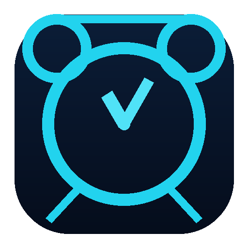

# Chronos 闹钟（深蓝科技风桌面版）



基于资料库「闹钟」文件夹中的 **Chronos 深蓝科技风设计系统** 改造而来的桌面闹钟软件。

- GitHub 仓库：[https://github.com/Wang-Yi-Hao/chronos-alarm](https://github.com/Wang-Yi-Hao/chronos-alarm)
- 直接下载（Windows）：[Releases](https://github.com/Wang-Yi-Hao/chronos-alarm/releases) → 下载 `Chronos-v1.0.0.zip`，解压后双击 `Chronos/Chronos.exe` 即可运行
用 `pywebview` 原生窗口承载这套 HTML/CSS UI，后端复用原 Windows 闹钟的核心逻辑
（Windows Toast 通知、`alarms.json` 持久化、单实例锁、贪睡）。

四大模块完整还原设计系统：**时钟主页 / 闹钟（列表·新建·编辑·删除·开关）/ 计时器 / 秒表**。

新增特性：

- **中国调休工作日**：新建/编辑闹钟时选择「工作日」，会自动按国务院公布的放假调休安排判断真实工作日（默认内置 2025、2026 年数据），遇节假日顺延、遇补班提前响。也可在数据目录放 `holidays.json` 自行扩展/更新。
- **自定义铃声**：闹钟表单支持上传本地音频文件（wav / mp3 / m4a / ogg 等），预设铃声会在首次运行时生成简单 WAV，提醒时通过 PowerShell MediaPlayer 异步播放。
- **系统托盘常驻**：点击窗口「关闭」按钮不会退出程序，而是**最小化到系统托盘**（右下角图标），闹钟继续在后台正常提醒；双击托盘图标或右键「显示窗口」可重新打开。右键托盘菜单「退出」才真正关闭。
- **开机自启**：顶栏新增「开机自启」开关。开启后会在「当前用户登录时自动后台启动（写入 `HKCU\...\Run`，带 `--hidden` 静默缩到托盘）」；关闭即移除。重启电脑后闹钟依旧会在后台准时响铃。

## 运行（开发模式）

```bash
pip install -r requirements.txt      # 安装 pywebview
python main.py                       # 启动（也可双击 run.bat）
```

首次运行会自动从上级目录（旧版 `alarms.json` / `settings.json`）迁移已有闹钟数据。

## 打包为 .exe（一键）

最简单：**双击 `build.bat`** 即可自动创建虚拟环境、安装依赖并完成打包。

或手动：

```bash
pip install pyinstaller
python -m PyInstaller build.spec --noconfirm --clean
```

产物为 `dist/Chronos/` 整个目录（`Chronos.exe` + 同目录的 `_internal/` 依赖）。
**双击 `dist/Chronos/Chronos.exe` 即可启动**，但必须连同 `_internal/` 一起分发（onedir 形态）。
`build.bat` 已指向专用虚拟环境 `...\envs\chronos`，首次运行会自动 `pip install pywebview pyinstaller`。

> 说明：
> - pywebview 在 Windows 上复用系统自带的 **WebView2**（Win10/11 内置），无需额外下载浏览器内核。
> - 若目标机器没有 WebView2 运行时，到微软官网安装「WebView2 Runtime（Evergreen）」即可。
> - 闹钟数据（`alarms.json` / `settings.json` / `ringtones/`）默认写在 `Chronos.exe` 同级目录，随 exe 便携移动。

## 命令行

| 参数 | 作用 |
| --- | --- |
| `--selftest` | 运行核心逻辑自检（时间计算、存取、迁移等），不弹窗 |
| `--test-notify` | 发送一条测试 Windows 通知 |

## 目录结构

```
chronos/
├── main.py            # pywebview 外壳 + ChronosAPI 后端桥接 + 到点检查线程
├── core.py            # 闹钟核心逻辑（无 GUI 依赖，可独立测试）
├── requirements.txt
├── build.spec         # PyInstaller onedir 配置
├── run.bat / build.bat
├── icon/              # 闹钟图标（appicon.ico / appicon.png / make_icon.py）
└── ui/
    ├── index.html     # 五视图结构：时钟/闹钟/新建表单/计时/秒表
    ├── style.css      # Chronos 深蓝科技风设计系统
    └── app.js         # 前端逻辑 + window.pywebview.api 桥接
```

## 数据

- 闹钟数据：`chronos/alarms.json`（首次运行从旧版迁移）
- 设置（声音提醒开关）：`chronos/settings.json`
- 节假日覆盖：`chronos/holidays.json`（可选，格式见下方）
- 铃声文件：`chronos/ringtones/`（预设 + 自定义上传）
- 单实例锁：`127.0.0.1:47932`

### holidays.json 格式示例

```json
{
  "2027": {
    "off": ["2027-01-01", "2027-02-11", "2027-02-12"],
    "work": ["2027-02-06", "2027-02-20"]
  }
}
```

## 已知限制

- 自定义铃声播放依赖 PowerShell + WPF MediaPlayer，因此上传的音频格式需为 Windows 原生支持的格式（wav / mp3 / m4a / ogg 等）。
- 铃声最长播放 30 秒，或播完自动停止。
- 设计系统的时间/日期字面量按中文环境展示。
